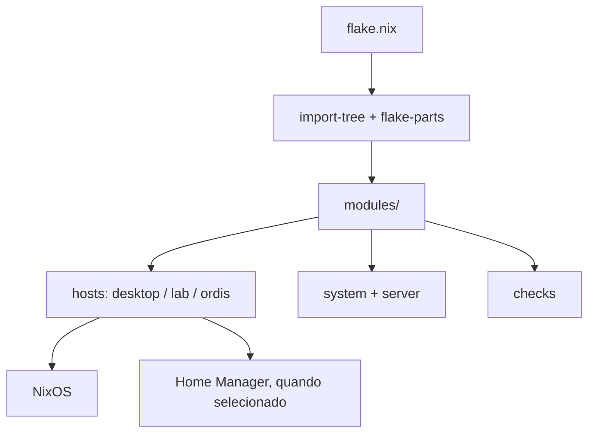

# dots

Configuração NixOS multi-host com flakes, Home Manager e módulos por domínio. Cada host seleciona as capacidades de que precisa; a configuração e os testes ficam no próprio repositório.

> O flake descreve o estado **desejado**, não necessariamente o sistema em execução. O `desktop` ainda roda CachyOS e não é gerenciado por este flake.

## Arquitetura



- `modules/hosts/<host>/modules.nix` seleciona capacidades para cada máquina; `_hardware-configuration.nix` é importado explicitamente.
- `modules/system/` reúne módulos de sistema, terminal, interface gráfica, usuários e rede.
- `modules/server/` contém serviços reutilizáveis, como Pi-hole.
- `modules/nix/` monta os outputs e define checks; `checks/` contém verificações de comportamento.
- `base` reúne a configuração comum de CLI, `gui` a interface gráfica e `desktop-personal` as capacidades exclusivas do desktop. Ordis não recebe Home Manager.

## Hosts

| Output | Papel | Estado |
| --- | --- | --- |
| `desktop` | Estação pessoal com Home Manager, Niri e i3 | NixOS planejado; CachyOS em uso |
| `ordis` | Servidor doméstico com Pi-hole, SSH e Tailscale | NixOS em uso |
| `lab` | VM isolada, sem rede nem compartilhamento do host | Somente testes |

## Verificar

Em Linux x86_64 com Nix e flakes habilitados:

```sh
nix fmt -- --check flake.nix
nix flake check --show-trace --no-write-lock-file
nix build --no-link --no-write-lock-file .#nixosConfigurations.ordis.config.system.build.toplevel
```

Troque `ordis` por `desktop` ou `lab` conforme o alvo. Os testes de runtime em KVM são packages separados, por exemplo `nix build --no-link -L .#packages.x86_64-linux.secret-runtime`. Build e VM não ativam a configuração nem validam o hardware real. A CI executa checks e builds dos hosts, mas não todos os testes de runtime.

## Segredos

SOPS/age guarda apenas **ciphertext** no Git. O módulo consumidor declara a fonte cifrada e a entrega em runtime; identidades age privadas, passphrases e tokens não entram no Git, no Nix store ou em logs publicados. Novas credenciais cifradas podem pertencer ao módulo que as utiliza, sem criar um arquivo central com todos os segredos.

- **Desktop:** a identidade age de recuperação é externa ao checkout. No sistema instalado, o sops-nix exige `/var/lib/sops-nix/key.txt` (`root:root`, `0600`), em diretório `0700`; no instalador, use o mesmo caminho sob `/mnt`. Guarde uma cópia recuperável independentemente da chave SSH cifrada. A chave SSH pessoal é entregue em `/run/secrets/rinyaresu-ssh-key` e ainda requer sua passphrase.
- **Ordis:** o hash administrativo do Pi-hole e o token DNS da Cloudflare são provisionados fora do Git, respectivamente em `/var/lib/pihole-secrets/admin-hash` e `/var/lib/pihole-secrets/cloudflare-dns-token`. Provisione o hash com `sudo pihole-admin-hash` e o token Cloudflare com permissão limitada à zona (`DNS: Edit`, `Zone: Read`), ambos fora do Git e com modo `0600`. TLS/ACME, Gravity e bancos de dados são estado persistente, não dados que um rebuild Nix restaura.
- **Tailscale:** cada instalação faz login próprio e mantém seu estado local. Não copie identidades ou estado de outro dispositivo.

## Instalação e recuperação

**Desktop NixOS:** obtenha uma revisão Git conhecida e o backup da identidade age por canais independentes da chave SSH que será restaurada. Antes de instalar, confirme o disco Linux e a EFI correta, preserve o disco/EFI do Windows, faça backup e confira o [layout Disko](modules/hosts/desktop/_disko-layout.nix). Para a migração do CachyOS, use somente o `formatMount` protegido, com revisão e autorização separadas; o procedimento específico está no [PR #16](https://github.com/Rinyaresu/dots/pull/16). O modo genérico de destruição está desabilitado. O instalador só deve ser usado após montar corretamente o sistema em `/mnt` e provisionar a identidade age no destino, com permissões restritas.

```sh
# Somente após identificar e montar o alvo autorizado em /mnt
nixos-install --option experimental-features 'nix-command flakes' --flake .#desktop
nixos-enter --root /mnt -c 'passwd rinyaresu'
```

No primeiro boot, confira `sops-install-secrets.service`, `home-manager-rinyaresu.service` e o serviço de usuário `pi-config-restore`. O bootstrap desbloqueia SSH com askpass e restaura os repositórios Home e Agent depois que a identidade estiver disponível; não restaura sessões, contas externas nem dados ignorados. O desktop usa Limine; preserve gerações e mídias de recuperação, e não dependa apenas de `nix-env --rollback` para o próximo boot.

**Ordis:** antes de aplicar mudanças, confira uma conexão SSH **nova**, sudo, DNS e o estado efetivo do firewall. Guarde uma geração funcional e backups consistentes dos dados do Pi-hole/Gravity e das credenciais externas. Teste a alteração antes de persistir; rollback Nix não reverte bancos migrados. Em caso de falha de rede ou boot, use console físico ou mídia de recuperação. O Pi-hole mantém um listener de recuperação em `127.0.0.1:8080`, acessível por túnel SSH autorizado. Para o legado de CA privada da geração 9, consulte o histórico do [PR #6](https://github.com/Rinyaresu/dots/pull/6) e do [PR #7](https://github.com/Rinyaresu/dots/pull/7), além do material privado preservado.

**Acesso remoto ao desktop:** SSH de entrada só é liberado pelo Tailscale com grant e chave OpenSSH. Chaves públicas autorizadas são provisionadas em `/var/lib/desktop-ssh/authorized_keys/rinyaresu`; privadas permanecem nos clientes. Para um dispositivo novo, faça login interativo na tailnet e valide uma conexão nova, sem reutilizar o estado Tailscale anterior. No cliente atualmente fixado, o fluxo observado é `sudo tailscale debug localapi POST login-interactive >/dev/null`; valide a versão antes de reaplicá-lo, sem executar `up --reset` por tentativa. A política real de acesso pertence ao host e à tailnet, não a este README.

Alterações de disco, deploy, reboot e rotação de credenciais são operações separadas dos checks e precisam de autorização e caminho de recuperação. Investigações, comandos excepcionais e evidências de implantação ficam nos respectivos PRs.
